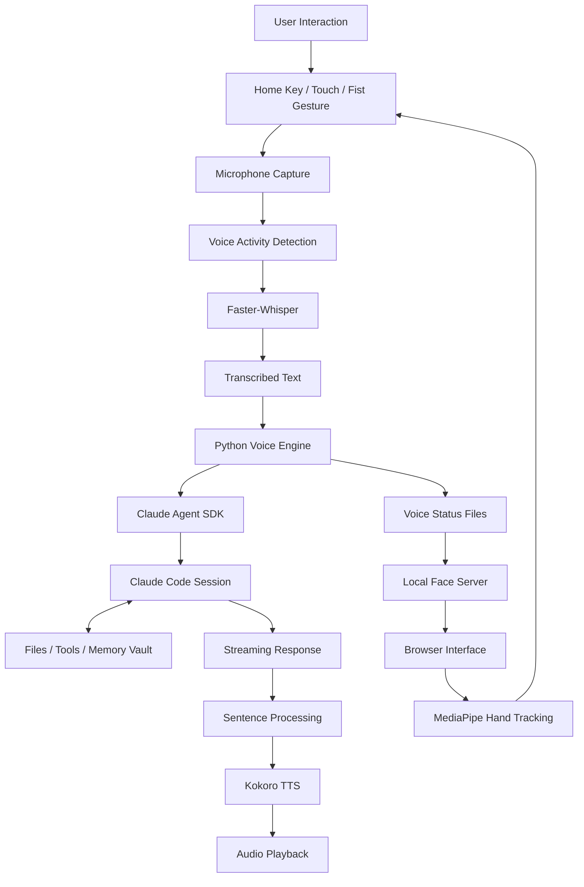
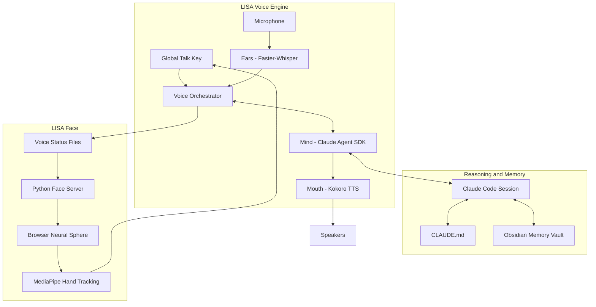

# L.I.S.A. — Life Integrated Smart Assistant 🤖

<div align="center">

### Listen. Think. Remember. Act.

**A Voice-First AI Chief of Staff That Connects Natural Conversation With Real Computer Workflows.**

[Features](#-key-features) · [Architecture](#️-system-architecture) · [Showcase](#-product-showcase) · [Installation](#-getting-started)

</div>

<p align="center">
  
  
  
  
  
  
</p>

---

## 🌌 Overview

**LISA (Life Integrated Smart Assistant)** is a voice-first personal AI chief of staff designed to move beyond traditional chatbot interactions.

LISA combines local speech recognition, AI-powered reasoning, computer interaction, structured long-term memory, and a custom animated interface into one intelligent assistant.

She can listen to spoken instructions, understand requests, work with files and applications, assist with daily planning, maintain persistent memory, and respond through natural speech.

Unlike conventional assistants that simply return text responses, LISA is designed around a complete interaction workflow:

**Listen → Understand → Think → Act → Respond**

Her voice pipeline runs locally using Faster-Whisper and Kokoro. Her current reasoning and computer-tool execution layer is powered by Anthropic's Claude through the Claude Agent SDK.

LISA also features a custom animated neural-sphere interface, real-time audio visualization, and webcam-based hand gesture interaction.

**Not just another chatbot. An assistant designed to become part of your everyday workflow.**

---

## ✨ Key Features

### 🎙️ 1. Voice-First AI Interaction

Interact with LISA through natural voice conversations.

- Global keyboard push-to-talk.
- Webcam-based fist gesture interaction.
- Touch-based interaction through the browser interface.
- Typed input support.
- Microphone capture and audio processing.
- Voice activity detection.
- Local speech transcription.
- Custom hotwords for improved recognition.
- Interruptible response handling.

### 👂 2. Intelligent Speech Recognition

LISA uses **Faster-Whisper** with the Whisper Small English model for local speech recognition.

- Local CPU-based speech transcription.
- CTranslate2 inference.
- INT8 quantization.
- Silero Voice Activity Detection.
- 16 kHz mono audio input.
- Greedy decoding for optimized performance.
- Custom hotword support.
- Post-transcription filtering.
- Silence and non-speech detection.

Microphone audio is processed locally and is not saved to disk during ordinary capture.

### 🧠 3. AI Reasoning and Agent Capabilities

LISA integrates the **Claude Agent SDK** to connect with a persistent Claude Code session.

This enables LISA to go beyond answering questions.

Depending on the configured permissions and available tools, she can:

- Read and write files.
- Execute terminal commands.
- Search project directories.
- Work with code and documents.
- Use available tools and integrations.
- Assist with research and technical workflows.
- Maintain context through a persistent agent session.

### 🗣️ 4. Natural Voice Synthesis

LISA uses **Kokoro** for local text-to-speech generation.

- Local speech synthesis.
- Multiple voice options.
- Configurable speaking speed.
- Sentence-level speech generation.
- Streaming audio playback.
- Separate rendering and playback workers.
- Interruption-aware audio management.

LISA can begin speaking complete sentences while the remaining response is still being generated.

### 🌐 5. Custom Animated Neural-Sphere Interface

LISA features a custom browser-based animated interface designed to make the assistant's current state visible.

Supported states:

- **Idle:** Waiting for interaction.
- **Listening:** Capturing the user's voice.
- **Thinking:** Processing the request.
- **Speaking:** Delivering a response.
- **Alert:** Displaying an error or attention state.

Additional features:

- Canvas-based neural-sphere animation.
- Live audio waveform visualization.
- Real-time interface updates.
- Custom sound effects.
- Touch-based interaction.
- Browser-based visual experience.

### ✋ 6. Webcam-Based Hand Gesture Recognition

LISA integrates **MediaPipe Tasks Vision** for browser-based hand tracking.

- Webcam-based hand tracking.
- Fist gesture interaction.
- Gesture-to-push-to-talk control.
- Local browser-side processing.
- Integration with the voice interaction system.

### 🧠 7. Persistent Long-Term Memory

LISA uses a structured external memory system powered by an **Obsidian Markdown vault**.

Her identity and operating instructions are defined in `CLAUDE.md`.

The memory vault contains:

- Central indexes.
- Linked Markdown notes.
- Daily notes.
- Project-specific information.
- Priorities and recurring responsibilities.
- Dedicated workflow instructions.

This approach keeps persistent knowledge outside the model's immediate context window and makes it easier to retrieve relevant information when needed.

### 📅 8. Personal Productivity and Study Assistance

LISA is designed to support recurring real-world workflows.

| Workflow | Description |
|---|---|
| Plan My Schedule | Organize daily and weekly schedules using timetable information. |
| Exam Prep | Create revision plans and conduct study quizzes. |
| Should I Skip This Class? | Evaluate attendance information before making recommendations. |
| Email Drafting | Prepare emails, with sending reserved for explicit instruction. |
| Project Assistance | Work with files, code, and ongoing technical projects. |
| Daily Memory | Maintain notes, priorities, and ongoing context. |

### ⚡ 9. Streaming and Interruptible Architecture

LISA is designed to reduce the delay between a user request and the first spoken response.

- Streaming reasoning responses.
- Sentence-level text processing.
- Overlapping speech generation and playback.
- Audio queue management.
- Interruption handling.
- Real-time interface state updates.
- Watchdog-based talk-key recovery.

---

## 🧭 How LISA Works

LISA connects multiple independent components to create a complete voice interaction experience.



### The Four-Step Interaction

**01 — LISTEN**

The user activates LISA using the configured talk key, touchscreen, or supported hand gesture. The microphone captures the audio.

**02 — UNDERSTAND**

Faster-Whisper processes the captured audio locally and converts speech into text.

**03 — THINK AND ACT**

The Claude Code session interprets the request, accesses its available tools, and performs the requested work within its configured permissions.

**04 — RESPOND**

The response streams back to the voice engine. Kokoro generates speech sentence by sentence while LISA's animated interface reflects her current state.

---

## 🖥️ Product Showcase

LISA's interface is designed to provide a visual representation of the assistant's current activity.

Add your actual project screenshots to the repository and reference them below.

### 01 — LISA Main Interface

*The custom animated neural-sphere interface.*


### 02 — Listening State

*LISA actively listening to the user's voice.*


### 03 — Thinking State

*LISA processing a request through her reasoning layer.*


### 04 — Speaking State

*LISA generating and delivering a spoken response.*


### 05 — Gesture Interaction

*Webcam-based hand tracking and gesture interaction.*


> Replace these example image paths with your actual screenshots before publishing. GitHub will show broken images until the corresponding files exist.

---

## 🛠️ Technology Stack

LISA uses a combination of Python-based voice processing, agent integration, browser-based visualization, and computer vision.

### Voice and Backend Development

| Technology | Purpose |
|---|---|
| Python 3.12 | Main application and voice engine |
| asyncio | Asynchronous orchestration |
| Faster-Whisper | Local speech recognition |
| CTranslate2 | Optimized model inference |
| Whisper Small English | Speech recognition model |
| Silero VAD | Voice activity detection |
| Kokoro | Local text-to-speech |
| PyTorch | Speech synthesis model execution |
| sounddevice | Microphone and speaker access |
| NumPy | Audio processing |
| pynput | Global keyboard interaction |

### AI and Memory

| Technology | Purpose |
|---|---|
| Claude Agent SDK | Agent session integration |
| Claude Code | AI reasoning and tool execution |
| Obsidian | Long-term memory management |
| Markdown | Identity, memory, and workflow instructions |

### Interface and Computer Vision

| Technology | Purpose |
|---|---|
| HTML5 | Browser interface |
| JavaScript | Interface logic |
| Canvas API | Animated neural-sphere visualization |
| MediaPipe Tasks Vision | Hand gesture recognition |
| Server-Sent Events | Real-time interface updates |
| Python HTTP Server | Local face server |

---

## 🏗️ System Architecture

LISA is built using independent cooperating processes instead of one monolithic application.



### Architectural Responsibilities

- **Voice Engine:** Coordinates microphone input, transcription, reasoning, speech generation, and interaction events.
- **Ears:** Converts captured speech into text using Faster-Whisper.
- **Mind:** Connects the voice engine to the Claude Agent SDK session.
- **Mouth:** Generates and plays speech through Kokoro.
- **Face Server:** Reads voice-state files and streams interface updates.
- **Browser Interface:** Renders the animated neural sphere and handles touch and gesture interaction.
- **Memory Vault:** Stores persistent project, personal, and workflow context.

### Design Philosophy

1. **Process separation:** The voice engine and face server operate independently.
2. **File-based communication:** Both programs communicate through small status files.
3. **Local voice processing:** Speech recognition and synthesis run on the computer.
4. **Streaming-first design:** Text, audio, and visual updates progress as work happens.
5. **Controlled concurrency:** The voice engine coordinates decisions through one asyncio event loop, while blocking operations are delegated to worker threads.

---

## 📂 Project Structure

```text
LISA/
│
├── CLAUDE.md
├── Talk to LISA.bat
│
├── lisa-voice/
│   ├── lisa_voice/
│   │   ├── __init__.py
│   │   ├── __main__.py
│   │   ├── settings.py
│   │   ├── log.py
│   │   ├── talk_key.py
│   │   ├── ears.py
│   │   ├── mind.py
│   │   ├── mouth.py
│   │   └── face.py
│   │
│   ├── requirements.txt
│   └── pyproject.toml
│
├── lisa-face/
│   ├── server.py
│   ├── settings.json
│   ├── run.bat
│   │
│   ├── web/
│   │   ├── index.html
│   │   ├── engine.js
│   │   ├── hands.js
│   │   └── models/
│   │
│   ├── sounds/
│   └── tools/
│       └── make_sounds.py
│
└── README.md
```

The Obsidian memory vault and certain runtime assets are maintained outside the main repository. Model weights, virtual environments, caches, logs, and runtime status files are not intended to be committed to Git.

---

## 🚀 Getting Started

### Prerequisites

Make sure you have:

- Windows 10/11.
- Python 3.12.
- `uv` Python package manager.
- Claude Code CLI.
- An authenticated Claude account with access to the configured model.
- Microphone and speakers.
- Webcam for gesture interaction.
- Internet connectivity for the Claude reasoning layer and initial model downloads.

A dedicated GPU is not required for the documented CPU-based configuration.

### 1. Clone the Repository

```bash
git clone https://github.com/saisharatkaruturi/LISA-Voice-Assistant.git
```

### 2. Navigate to the Project

```bash
cd LISA-Voice-Assistant
```

### 3. Install `uv`

Follow the official installation instructions:

https://docs.astral.sh/uv/

### 4. Create the Python Environment

```bash
cd lisa-voice
uv venv --python 3.12 .venv
```

### 5. Install Dependencies

```bash
uv pip install --python .venv\Scripts\python.exe -r requirements.txt
```

### 6. Install and Authenticate Claude Code

Follow the official documentation:

https://docs.anthropic.com/en/docs/claude-code/overview

Make sure the `claude` command is available in your terminal and authentication is complete.

LISA uses the Claude Agent SDK to connect to the Claude Code session.

### 7. Prepare the Speech Models

LISA requires the Faster-Whisper Small English model and Kokoro model assets.

The documented Whisper model location is:

```text
lisa-voice/models/faster-whisper-small.en/
```

Model weights are not included in the Git repository and must be downloaded separately.

Kokoro model and voice assets are obtained through its model cache.

Install eSpeak NG separately if it is not already available:

https://github.com/espeak-ng/espeak-ng

### 8. Review Configuration

Review the following files:

```text
lisa-voice/voice.json
lisa-face/settings.json
```

These files control voice selection, speaking speed, microphone selection, talk key, face server, sound effects, and gesture settings.

Keep the configured talk key consistent between the voice and face settings.

### 9. Launch LISA

After completing setup and reviewing machine-specific paths, run:

```text
Talk to LISA.bat
```

The launcher starts the voice engine and face interface. The face opens in the default browser.

**Note:** The documented launcher and default configuration use machine-specific paths. Review and adjust them when installing LISA on another computer. The project is not currently a fully portable one-click installer.

---

## ⚡ Performance

The following measurements were recorded on the development laptop using CPU-based processing.

| Operation | Observed Performance |
|---|---:|
| Startup to greeting | ~30 seconds |
| Empty key press | ~0.01 seconds |
| Speech transcription | ~2.7 seconds |
| Claude session connection | ~2 seconds |
| First reasoning response sentence | ~2 seconds |
| Kokoro first audio | ~1.8–2.7 seconds per sentence |
| Interrupt response | Under ~70 ms of audio |
| Face status updates | 15 updates/second |
| Release-to-first-audio experience | ~5–7 seconds |

These measurements represent one development environment and are not guaranteed benchmarks. Performance varies depending on CPU resources, model loading, network conditions, and request complexity.

---

## 🔐 Security and Privacy

LISA follows a local-first approach for voice processing, while using a cloud-based reasoning layer.

### Local Processing

- Microphone audio is processed locally.
- Ordinary voice recordings are not saved to disk by the capture pipeline.
- Webcam hand tracking runs in the browser.
- The face server listens on `127.0.0.1`.
- The talk endpoint uses a custom request header and CORS preflight protection.
- A watchdog helps prevent a stuck simulated talk key.

### Cloud Processing

LISA's current reasoning layer uses Anthropic's Claude service through Claude Code.

**Transcribed text and conversation content are sent to the Claude service.**

Therefore, LISA is not currently a fully offline AI assistant.

### Permission and Safety Considerations

The documented voice session uses `bypassPermissions` mode. This allows configured tools to run without asking for individual approval and is an important security trade-off.

- Run LISA only in a trusted environment.
- Understand the permissions granted to the agent.
- Avoid placing passwords, tokens, and credentials in memory notes.
- Never commit private memory files or sensitive configuration to GitHub.

---

## 🧪 Troubleshooting

| Problem | Possible Cause | Recommended Check |
|---|---|---|
| LISA does not start | Package or model problem | Inspect `lisa-voice/logs/console-errors.txt`. |
| Talk key does not work | Voice process stopped or mismatched key | Confirm the process is ready and both talk-key settings match. |
| Speech is not recognized | Wrong or muted microphone | Check Windows input levels and microphone selection. |
| LISA hears her own voice | Interruption audio handling issue | Check the audio-discard logic and microphone/speaker setup. |
| Face is frozen | Voice process stopped or incorrect bus folder | Check the voice window and face configuration. |
| Face has no sound | Missing audio dependency or output device | Check `numpy`, `sounddevice`, and the selected output device. |
| Port 7420 is occupied | Another face server is running | Close the old server or change the configured port. |
| Claude session fails | Network, authentication, or service issue | Check connectivity, authentication, and logs. |
| Transcription is slow | CPU load or decoding configuration | Check system load and greedy decoding settings. |
| Laptop sleep freezes LISA | Windows power management | Review sleep settings while LISA is running. |

---

## 🗺️ Future Roadmap

LISA's long-term vision is to evolve into a more capable personal AI operating system.

Potential development areas include:

- More portable installation and configuration.
- Local language-model reasoning for offline operation.
- Clearly separated offline and online operating modes.
- Multilingual speech recognition and synthesis.
- Lower-latency and more natural voice interaction.
- Expanded multimodal perception.
- More advanced long-term memory retrieval.
- Improved agent orchestration and task verification.
- Stronger permission controls and action auditing.
- Expanded browser and desktop automation.
- Cross-device access and synchronization.

These are future development directions, not claims that every capability is already implemented.

---

## 📚 Credits and Open-Source Technologies

LISA is an independently designed and directed project.

Its concept, identity, personality, memory organization, recurring workflows, interface direction, architecture, and engineering requirements were designed by Sharat. AI-assisted development, including Claude Code, was used extensively under that direction.

LISA builds on open-source technologies, including:

- [Faster-Whisper](https://github.com/SYSTRAN/faster-whisper)
- [CTranslate2](https://github.com/OpenNMT/CTranslate2)
- [Kokoro-82M](https://github.com/hexgrad/Kokoro-82M)
- [MediaPipe](https://github.com/google-ai-edge/mediapipe)
- [PyTorch](https://pytorch.org/)
- [python-sounddevice](https://python-sounddevice.readthedocs.io/)
- [pynput](https://github.com/moses-palmer/pynput)
- [Obsidian](https://obsidian.md/)
- [Claude Code](https://docs.anthropic.com/en/docs/claude-code/overview)

Each dependency and model remains subject to its own license. Refer to the original projects for their terms.

---

## 📄 License

The repository does not currently declare a single project-wide open-source license. Third-party dependencies retain their respective licenses.

Add a project-level `LICENSE` file before granting others permission to reuse, modify, or redistribute LISA's code.

---

<div align="center">

# L.I.S.A.

### Life Integrated Smart Assistant

**LISTEN → THINK → REMEMBER → ACT**

Designed and directed by **Sharat**

[GitHub Repository](https://github.com/saisharatkaruturi/LISA-Voice-Assistant)

*An assistant should do more than respond. It should help you move forward.*

</div>
